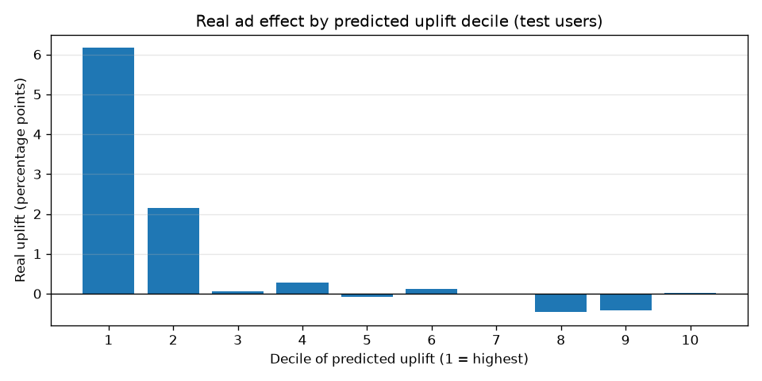
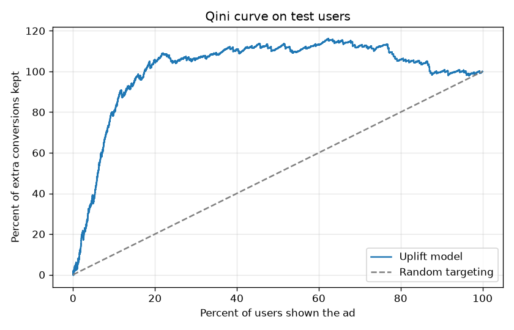

# Checkout Insights Engine

I started this project with a simple A/B test. Did showing people a real ad get them to buy more than showing them a public service announcement? It did. The ad group converted at 2.55% and the PSA group at 1.79%, across 588,101 real users.

But that number bothered me. It is an average over half a million people and I wanted to know if the ad was helping everyone a little, or a few people a lot. So I built a model to find out.

It turned out to be the second one. When I ranked users by how much the ad was predicted to help them, the top 20% accounted for almost all of the extra purchases. For the other 80%, the ad did basically nothing.

## What I found

| Question | What I did | What came out |
|---|---|---|
| Does the ad work on average? | Chi square test | Yes. 2.55% vs 1.79%, χ² = 54.0, p < 0.001 |
| Can I predict who will buy? | Logistic regression I wrote in NumPy | ROC AUC 0.86, PR AUC 0.139 (random guessing gets 0.025) |
| Who does the ad actually help? | Two model uplift approach | Top 20% of users: 4.07 point lift. Everyone else: about 0 |
| Could that just be luck? | Bootstrap, 300 resamples | No. The 95% range is 3.22 to 5.06 points |

Every model number above comes from users the models never saw while training.



## How it is built

The project has three notebooks. Each one picks up where the last one stopped.

### 1. The A/B tests

File: `Checkout_Funnel_AB_Testing.ipynb`

I ran three tests, each with a written hypothesis, a control group, a treatment group, and one yes or no outcome, so a chi square test fits every time.

| Test | Groups | Data | χ² |
|---|---|---|---|
| 1 | PSA vs ad | Real, Kaggle, 588,101 users | 54.0 |
| 2 | Forced signup vs guest checkout | Simulated | 324.92 |
| 3 | Long form vs short form | Simulated | 206.73 |

Companies do not publish their checkout experiments, so for Tests 2 and 3 I simulated the data using completion rates from published checkout research. The sources are in the notebook. Test 1 is real, but 96% of users were in the ad group and only 4% in the PSA group, so the PSA rate is less precise. I point this out in the notebook instead of hiding it.

### 2. Predicting who converts

File: `Conversion_Model_Logistic_Regression.ipynb`

I wrote logistic regression in NumPy instead of calling a library, using what I learned in CS 6140 Machine Learning at Northeastern. That means writing out the sigmoid, the cross entropy loss, its gradient, and the update rule for mini batch gradient descent myself. I used 5 fold cross validation to pick the regularization strength.

A few choices I had to think about:

- Only 2.5% of users ever buy. A model that just says "nobody buys" would be 97.5% accurate and completely useless, so I measured PR AUC and recall instead of accuracy.
- Hour 23 and hour 0 are next to each other, but as plain numbers they look far apart. I turned the hour into sine and cosine so the model sees it as a circle.
- Some users saw over 2,000 ads while most saw under 30, so I used the log of ad count to stop a few heavy users from pulling the model around.

To make sure my math was right, I trained scikit learn on the same data and compared. My weights matched within 0.03.

One result surprised me. Cross validation picked no regularization at all. With 10 features and 350,000 rows there is nothing to overfit, and I would rather test that than assume regularization always helps.

### 3. Finding who the ad helps

File: `Uplift_Model_Ad_Targeting.ipynb`

This is the part I am proudest of. I trained two copies of my model, one only on people who saw the ad and one only on people who saw the PSA. For each user the difference between the two predictions is how much the ad is expected to change their chance of buying.

The real test is whether that ranking holds up on new users. I split the held out users into 10 groups by predicted uplift and measured the actual ad vs PSA gap inside each. Since users were randomly assigned, that gap is a fair read of the true effect.

The top group showed a 6.2 point lift the second group 2.2, and groups 3 through 10 were all close to zero. Showing the ad to just the top 10% would have kept 80% of the extra purchases.



There is a catch, and I think it matters. The strongest feature is how many ads a person saw, which is counted during the experiment. More engaged people see more ads, so a company could not use this feature to pick targets in advance. A real version would need something known before the campaign starts, like past visits or past purchases.

## Dashboard


I built a Power BI dashboard with a page for each test and a summary page: conversion rates by group, sample sizes, and the chi square result for each. File: [checkout_funnel_dashboard.pbix](./checkout_funnel_dashboard.pbix)

## Database and app

I also wanted to see what the system behind a store like this would look like, so I designed the database for it in my CS 5200 class.

- `schema.sql` has 9 MySQL tables for customers, products, categories (which can have subcategories), inventory, promotions, orders, order items, and reviews
- `triggers_procedures.sql` lowers inventory automatically when an order comes in, blocks orders that would sell more than is in stock, and has stored procedures for monthly revenue and customer lifetime value
- `ab_test_results_addition.sql` stores the real results of the three A/B tests, so the database and the notebooks agree
- `mongodb_setup.js` holds review text and click events in MongoDB, since that data does not fit neatly into fixed tables
- `app.py` is a small Flask app that runs the stored procedures from a browser
- `ERR1.png` is the EER diagram, and `relational_algebra_queries.md` shows the relational algebra next to the SQL for the main queries

To run the app:

```
pip install flask mysql-connector-python
set DB_PASSWORD=your_mysql_password
python app.py
```

Then go to `http://127.0.0.1:5000`. The password is read from an environment variable not written in the code.

## Tools

Python (NumPy, pandas, SciPy, scikit learn, Matplotlib), Jupyter, Power BI, MySQL, MongoDB, Flask

## Data

Test 1 and both models use the [Marketing A/B Testing dataset](https://www.kaggle.com/datasets/faviovaz/marketing-ab-testing) by FavioVaz on Kaggle. Tests 2 and 3 are simulated, as explained above.

## About me

I am a Master's student in Computer Science at Northeastern University's Khoury College in Boston. I picked checkout because I have personally given up on online orders over forced signups and long forms, and I wanted to see whether the data backed up that frustration. What I took away from this project is that "did it work" is only the first question. The more useful one is "who did it work for".

GitHub: [github.com/mohanaHarshita4](https://github.com/mohanaHarshita4)
LinkedIn: [linkedin.com/in/mohana-harshita](https://linkedin.com/in/mohana-harshita)
